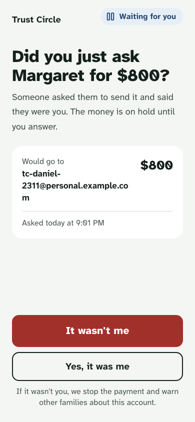
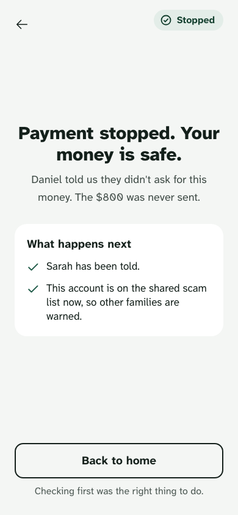
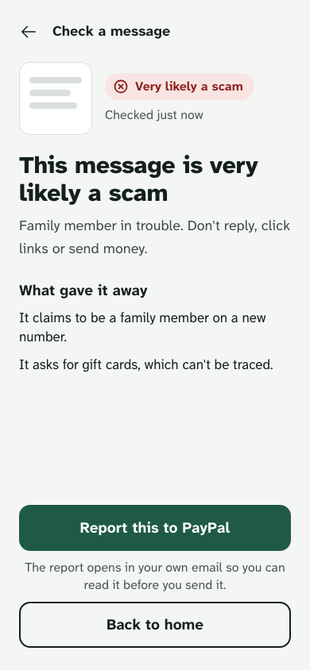
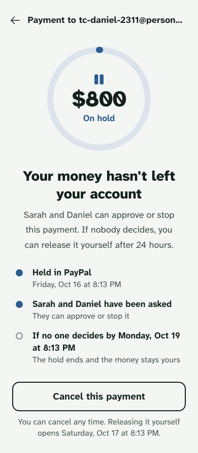
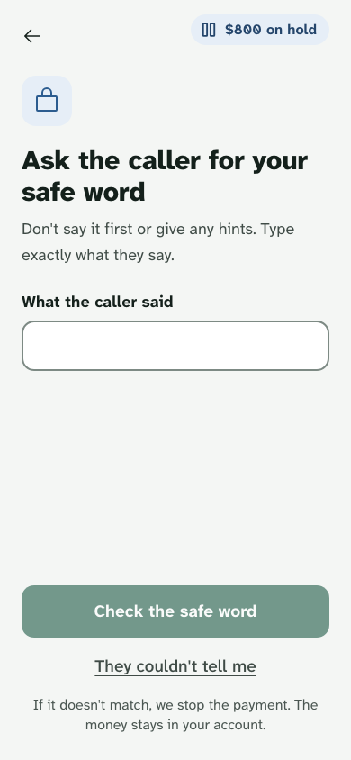
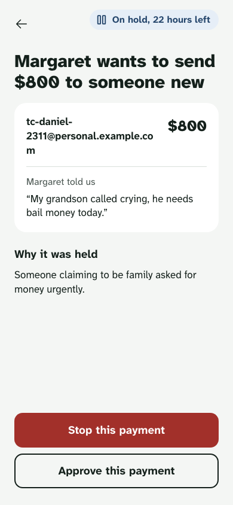
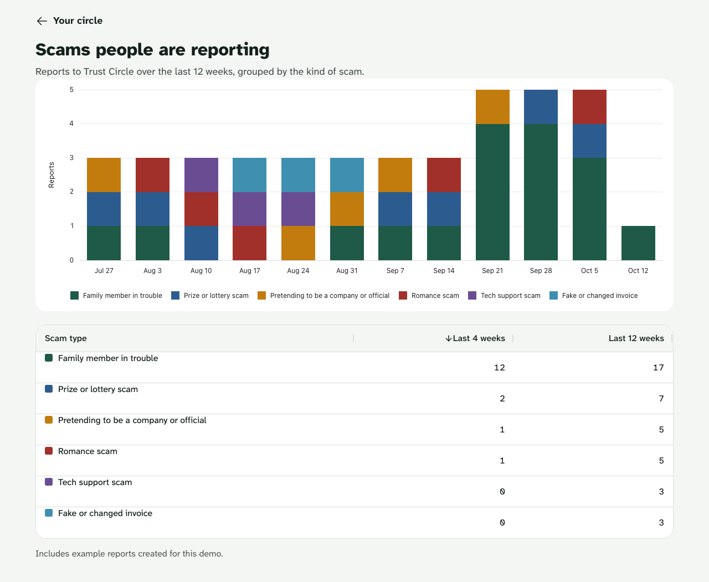
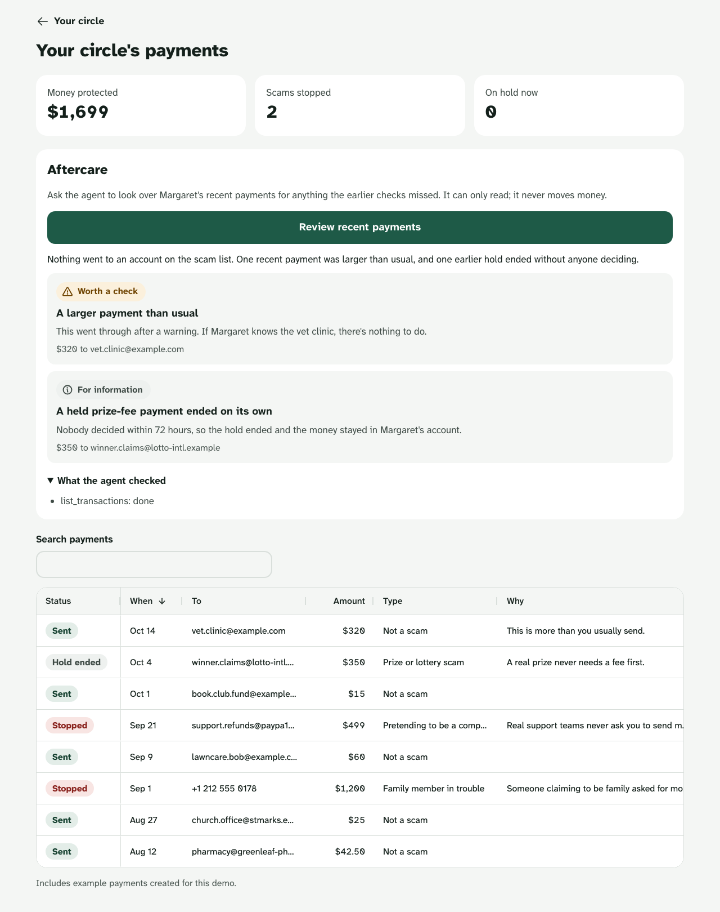
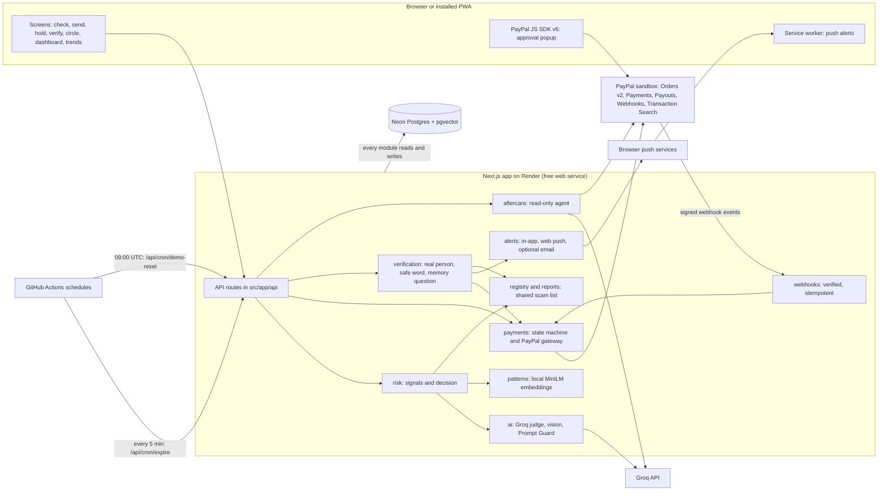

# Trust Circle

**Scammers pretend to be someone you trust. So we ask that person.**

<p align="center">
  
  
</p>

Trust Circle holds a risky PayPal payment and checks with the person the scammer is pretending to be, and with the sender's family, before any money moves. It runs entirely in the PayPal sandbox. No real money moves.

**Built with:** PayPal Orders v2 (authorize, capture, void), Payouts, verified Webhooks, Agent Toolkit · Groq · AG Grid / AG Charts · Render

- Live demo: {{DEMO_URL}}
- Video (under 3 minutes): {{VIDEO_URL}}
- Devpost: [PayPal AI Hackathon](https://paypalaihackathon.devpost.com/)

The live demo runs on a free Render service. If it has been asleep, the first page can take about a minute to load.

## Try it in two minutes

The landing page signs you in as a demo person with one tap. There is no sign-up.

| Person | Role |
|---|---|
| **Margaret** | The sender (Family preset). Her circle is Sarah and Daniel. |
| **Sarah** | Margaret's daughter, in her circle. Sees the dashboard, trends and aftercare. |
| **Daniel** | Margaret's grandson, the real person a scammer pretends to be. |
| **Priya** | A freelancer (Business preset). Her accountant **Tom** is her circle. |
| **Robert** | Just me (no circle). |

**As Margaret**

1. Tap **Try as Margaret**, then **Check a message**. Paste:
   > Hi Grandma it's me, I lost my phone so this is my new number. I need $800 in gift cards today. Please don't tell mom. Text me at +1 (415) 555-0199

   You get "This message is very likely a scam" and what gave it away.
2. Go back home and tap **Send money**. Pay `daniel.newphone@example.com` $800. When asked who asked you and why, write: *My grandson Daniel called crying, he's in jail and needs bail money today.*
3. Trust Circle says "Let's pause before this goes". Tap **Continue, and let Sarah review it**, and approve in the PayPal sandbox window. **The PayPal sandbox buyer login for this step is in the Devpost testing instructions, not in this repo.**
4. The payment is approved in PayPal but held: the money hasn't left Margaret's account. The screen tells her Trust Circle has asked Daniel whether it was really him.

**As Daniel, then Sarah**

5. Sign out, open **Other demo accounts** on the landing page and choose **Daniel, the grandson**. Open the request and tap **It wasn't me**. The authorisation is voided and the payee goes on the shared scam list.
6. Sign back in as Margaret: "Payment stopped. Your money is safe."
7. Sign in as **Sarah** (**Try as Sarah, her daughter**). Her circle shows what happened. Tap **See all payments** for the dashboard (AG Grid) and **Review recent payments** for the aftercare agent, then go back and open **Scam trends** (AG Charts).

The shared demo resets to its clean story every day at 09:00 UTC.

## The problem

**In 2025, people 60 and over reported losing $7.7 billion to online fraud.** 201,266 complaints to the FBI. Source: [FBI IC3 2025 Internet Crime Report](https://www.ic3.gov/AnnualReport/Reports/2025_IC3Report.pdf).

Many scams work by borrowing someone's trust: a grandchild, a bank, PayPal itself. Trust Circle doesn't try to out-guess every new script. It goes to the person being impersonated and lets them say no.

## How it works

### 1. Check a message



Paste a text or add a screenshot. Groq judges it (a vision model reads screenshots) and returns a verdict, a scam type and up to three plain reasons. Before that, Meta's Prompt Guard model screens the text for instructions aimed at the AI. Phone numbers, emails and links in the message are remembered, so a later payment to a party from a message judged a scam is held. A message the AI couldn't check is shown as unchecked, never as safe. One tap drafts a report to `phishing@paypal.com` in your own email app.

<br clear="right">

### 2. Guarded send and the hold



Every payment is assessed before PayPal is involved. Signals are computed in code: the shared scam list, a linked scam message, first-time payee, an unusual amount, the circle's limit, rapid repeats, a known scam pattern and hidden instructions. Then the AI gives its judgement. Low risk goes straight through. Medium risk shows a warning and tells the circle. High risk can still go ahead, but it is only **authorised** in PayPal and held: the sender has "done it", so the pressure is off, yet the money hasn't left. Sarah can approve or stop it. After the cooling-off period (24 hours by default) Margaret can release it herself, and after 72 hours with no decision the authorisation is voided.

<br clear="right">

### 3. Ask the real person


When the sender's answer names someone ("my grandson Daniel"), the AI identifies who is being impersonated. If that person is in the circle, they get an alert: "Did you just ask Margaret for $800?" **It wasn't me** voids the payment and puts the payee on the shared scam list. **Yes, it was me** releases it. If the claimed requester is an organisation, such as a bank or PayPal support, the app shows how to reach it through official routes and keeps the payment held. When the sender says a claimed company is connected to their computer or phone (the remote-access "refund" scam, where a fake balance is shown on screen), the payment is always held and the first step is to end the connection. With a circle, the decision is made on another person's phone, which the scammer can't control.

<br clear="right">

### 4. The safe word and the memory challenge



If the real person doesn't answer within 10 minutes, the sender is coached through a challenge: the safe word set at onboarding (stored only as a hash), or a memory question if there isn't one. The challenge is one-way. A wrong answer or an excuse stops the payment. A right answer never releases a high-risk payment by itself; it still waits for the circle or the cooling-off period.

<br clear="right">

### 5. The circle decides



Sarah sees the amount, the payee, what Margaret said and why the payment was held, and taps **Stop this payment** or **Approve this payment**. Stop voids the authorisation. Approve captures it and pays the payee out through PayPal Payouts. Both are claimed in the database before PayPal is called, so two taps can't move money twice.

<br clear="right">


Margaret gets a calm, blame-free result. Every line on it is backed by something that really happened: Sarah is only "told" because an alert really went to her.

<br clear="right">

### 6. The shared scam list and patterns



A reported scam adds its identifiers to a shared list as unconfirmed. An entry is confirmed when a contact stops a payment to it, a real person says "It wasn't me", or two different people report it. A payment to a confirmed entry is high risk for every user. The AI also writes a short anonymised description of each reported script. It is embedded with a local MiniLM model and stored in pgvector, so a reworded version of a known scam is caught even when every phone number and link is new. Only the anonymised description is stored, never the message. The trends page groups reports by scam type over 12 weeks.

### 7. Aftercare



*The findings in this screenshot are a sample report in the app's real format, so the picture doesn't depend on a live model run.*

From the dashboard, Sarah can ask an agent to review Margaret's recent payments for anything the earlier checks missed. The agent can only read: its PayPal tools are `list_transactions` and `get_order`, scoped in code to Margaret's own payments. Findings are graded "Needs action", "Worth a check" or "For information", and "What the agent checked" lists every tool call. If a completed payment went to an account that is now on the scam list, the finding says so and Sarah can copy a dispute draft. The app never sends it and never moves money.

## How PayPal is used

| PayPal capability | What Trust Circle does with it | File |
|---|---|---|
| Orders v2, intent `AUTHORIZE` | Creates an order for each payment, with the payment id as `custom_id` | `src/payments/paypalGateway.ts` (`createAuthorizeOrder`) |
| JavaScript SDK v6 | The sender approves in PayPal's own window | `src/app/send/PayPalApprove.tsx`, `src/app/send/sdkLoader.ts` |
| Authorize, capture, void | Authorise after approval and hold; capture on approval; void on stop or expiry | `src/payments/paypalGateway.ts`, `src/payments/paymentService.ts` |
| Payouts | Pays the payee by email or phone after capture | `src/payments/paypalGateway.ts` (`sendPayout`) |
| Refunds | Refunds the sender when a payout fails | `src/payments/paypalGateway.ts` (`refundCapture`), `src/payments/paymentService.ts` |
| Webhooks, verified online | Checks every event with `/v1/notifications/verify-webhook-signature`, stores it once per event id, and turns a returned, failed, blocked, canceled or refunded payout into `payout_failed`, which the sweep then refunds | `src/app/api/paypal/webhook/route.ts`, `src/webhooks/webhookService.ts` |
| Agent Toolkit (`@paypal/agent-toolkit`) | Aftercare, read-only: `list_transactions` and `get_order` only. Disputes and refunds are not exposed. | `src/aftercare/tools.ts` |

Every money-moving PayPal call carries a `PayPal-Request-Id` derived from the payment id, so a retry can't move money twice. The server SDK is `@paypal/paypal-server-sdk`. The gateway refuses any base URL other than the sandbox.

## How AI is used

| AI piece | What it does | File |
|---|---|---|
| Groq text model (`GROQ_TEXT_MODEL`) | Judges payments and messages, names the impersonated person, describes scam patterns, and drives the aftercare tool loop. Every answer is JSON checked against a schema. | `src/ai/groqJudge.ts`, `src/ai/groqMessageJudge.ts`, `src/ai/patternDescriber.ts`, `src/aftercare/aftercareAgent.ts` |
| Groq vision model (`GROQ_VISION_MODEL`) | Reads screenshots of messages | `src/ai/groqMessageJudge.ts` |
| Prompt Guard (`meta-llama/llama-prompt-guard-2-86m` on Groq) | Flags text that tries to give instructions to the AI. A score of 0.9 or more makes the check high risk. | `src/ai/promptGuard.ts` |
| Local MiniLM embedding (`Xenova/all-MiniLM-L6-v2`) | Turns anonymised scam scripts into vectors inside the server process, for pattern matching in pgvector (similarity threshold 0.35) | `src/patterns/embedder.ts`, `src/patterns/patternService.ts` |
| Agent Toolkit tool loop | At most 4 model tool calls in 18 seconds, over a fixed read-only allow-list. Any other tool is refused and recorded. | `src/aftercare/aftercareAgent.ts`, `src/aftercare/tools.ts` |

The text model used for the evaluation below was `qwen/qwen3.8-27b` (see [docs/eval/results.md](docs/eval/results.md)). The vision model is whatever `GROQ_VISION_MODEL` names.

Two rules hold everywhere:

- **The AI can raise the risk level, never lower it.** The final level is the higher of the rule level and the AI's level (`src/risk/decide.ts`).
- **It fails closed.** If the AI is unavailable or its answer fails the schema, a payment with any signal is held. A message is shown as unchecked, never as safe.

Text from messages, payments and tool results is treated as data. The prompts say so, and the aftercare agent's output is checked against a fixed schema.

## Accuracy

From [docs/eval/results.md](docs/eval/results.md): run 2026-10-16 on 76 invented cases (41 scams, 35 genuine) against Groq: text model `qwen/qwen3.8-27b`, injection screen `meta-llama/llama-prompt-guard-2-86m`. Pattern matcher on (10 known patterns, threshold 0.35).

| Measure | Result |
|---|---|
| Scams flagged (warning or hold) | 41 of 41 (100%) |
| Scams held | 41 of 41 (100%) |
| Genuine cases given a warning or hold | 11 of 35 (31%) |
| Genuine cases held | 2 of 35 (6%): one by the pattern matcher, one because the AI timed out and the app held it to be safe |
| Cases the AI could not check after one retry | 2 (Groq timeouts: the payment was held and the message was shown as unchecked, never as safe) |

Gate: at least 90% of scams flagged and at most 10% of genuine cases held. Result: pass.

### What the AI adds

The same run, scored on payments with the rules alone (first-time payee, unusual amount, circle limit, rapid repeats, the scam list):

| Payments (23 scams, 20 genuine) | Scams held | Genuine held |
|---|---|---|
| Rules and AI (as the app runs) | 23 of 23 | 2 of 20 (one after an AI timeout) |
| Rules alone, holding only what they rate high | 0 of 23 | 0 of 20 |
| Rules alone, holding everything they warn about | 17 of 23 | 7 of 20 |

No rules-only setting matches the AI. Six of the scams are deliberately hard for rules: an everyday amount to a new payee, or a payee already paid (a friend's hacked account). The rules see nothing wrong; the AI reads the sender's own words and holds all six. Scam messages have no rules-only score at all: without AI, nothing reads the text.

**Reading it honestly.** The AI can only raise a rule's level, never lower it, so the six hard genuine payments (a roofer's deposit, a funeral home, a new contractor, an apartment deposit, a garage bill, a friend's cabin share) keep the rules' warning. They still go through after the warning. In this run one of them was held only because the AI timed out, which is the app's safe fallback. 4 false alarms come from the pattern matcher, whose seed patterns are likely too broad for some ordinary messages. If the AI is unavailable, the app holds any payment with a rule signal: that holds 22 of 23 scams but also 11 of 20 genuine payments, and the payee-already-paid scam goes through. The set is 76 hand-written cases (the 12 hard payments and 4 remote-access cases were committed before the runs that scored them), so these numbers show behaviour on known situations, not real-world rates. This is a single run, and a repeat run can differ slightly. Run it yourself with `npm run eval:live`.

## Architecture



| Module | Folder | Responsibility |
|---|---|---|
| `risk` | `src/risk` | Signals in code, then the decision: the higher of rules and AI |
| `ai` | `src/ai` | Groq client, prompts, schema checks, Prompt Guard |
| `payments` | `src/payments`, `src/domain` | PayPal orders, authorise, capture, void, payout, refund; the state machine; the self-healing sweep |
| `verification` | `src/verification` | The real-person check, safe word, memory question, official routes |
| `registry` | `src/registry`, `src/reports`, `src/patterns` | Shared scam list, confirmation rules, report drafts, pattern matching |
| `alerts` | `src/alerts`, `src/push` | In-app alerts, web push, optional email |
| `aftercare` | `src/aftercare` | The read-only agent and the dispute draft |
| `webhooks` | `src/webhooks` | Verified, idempotent PayPal events |
| UI | `src/app`, `src/ui` | Next.js App Router screens, AG Grid and AG Charts |

The lead-story sequence diagram, the payment state machine and the webhook and aftercare details are in [docs/architecture.md](docs/architecture.md).

## Sponsor tools

- **AG Grid and AG Charts.** The circle dashboard's payment table is AG Grid (`src/app/circle/dashboard/DashboardGrid.tsx`), and the scam trends page uses AG Charts for the stacked bar chart and AG Grid for the table (`src/app/trends/TrendsView.tsx`).
- **Render.** The app is hosted on a Render free web service, defined by the Blueprint in [`render.yaml`](render.yaml).

## Run it locally

**Prerequisites:** Node 22 (22.12 or later), Docker, a PayPal sandbox app (client id and secret) and a Groq API key.

```bash
cp .env.example .env.local      # then fill in the values below
docker compose up -d            # Postgres with pgvector: db on 5433, db-test on 5434
npm ci
npm run db:migrate
npm run seed && npm run seed:patterns && npm run seed:history
npm run dev                     # http://localhost:3000
```

`seed:patterns` downloads the embedding model the first time.

| Variable | Required | What it is |
|---|---|---|
| `PAYPAL_CLIENT_ID`, `PAYPAL_CLIENT_SECRET` | Yes | Sandbox app credentials |
| `PAYPAL_ENV` | Yes | `sandbox` (anything else is refused) |
| `NEXT_PUBLIC_PAYPAL_CLIENT_ID` | Yes | Same client id, for the browser |
| `DATABASE_URL` | Yes | Local default in `.env.example` |
| `GROQ_API_KEY` | Yes | Groq console |
| `GROQ_TEXT_MODEL` | Yes | Groq text model name (the evaluation used `qwen/qwen3.8-27b`) |
| `GROQ_VISION_MODEL` | Yes | Groq vision model name, for screenshots |
| `GROQ_GUARD_MODEL` | No | Defaults to `meta-llama/llama-prompt-guard-2-86m` |
| `SESSION_SECRET` | Yes | At least 32 characters |
| `CRON_SECRET` | Yes | At least 24 characters, for the cron routes |
| `APP_URL` | No | Public address used in links |
| `PAYPAL_WEBHOOK_ID` | No | Sandbox webhook id; empty turns webhooks off |
| `RESEND_API_KEY`, `ALERT_FROM_EMAIL` | No | Alert email; empty sends no email |
| `NEXT_PUBLIC_VAPID_PUBLIC_KEY`, `VAPID_PRIVATE_KEY`, `VAPID_SUBJECT` | No | Push alerts. Set all three or none |
| `DEMO_DAILY_RESET` | No | `1` lets the daily job reset the shared demo |
| `TEST_DATABASE_URL`, `SANDBOX_*`, `E2E_ALLOW_RESET` | Tests only | See `.env.example` |

A broken optional setting turns that feature off with one warning; a missing required setting is named in the log and the app answers 500.

**Tests**

```bash
npm test                 # unit tests (Vitest)
npm run test:int         # integration tests against db-test
npm run typecheck
npm run lint
npx playwright test      # end to end; the PayPal stories need the SANDBOX_* values
```

**Push alerts (optional).** Run `npm run vapid:keys`, put the three values in `.env.local` and restart.

## Deploy

Render (web service), Neon (Postgres with pgvector) and GitHub Actions (schedules), all on free tiers. Step by step: [docs/deploy.md](docs/deploy.md).

## Where this goes

Trust Circle is meant to become a setting, not another app. A scammer can always tell a victim to pay somewhere else, so protection has to live where people already pay. Everything here uses PayPal's public APIs, so PayPal could offer it as a "Trusted Contact" option on any account: name someone you trust, and risky payments wait for them before the money leaves.

US brokerage already works this way: firms must make reasonable efforts to collect a trusted contact ([FINRA Rule 4512](https://www.finra.org/rules-guidance/rulebooks/finra-rules/4512)) and may temporarily hold a disbursement when they reasonably believe an adult 65 or older is being financially exploited ([FINRA Rule 2165](https://www.finra.org/rules-guidance/rulebooks/finra-rules/2165)). Trust Circle brings that protection to everyday payments, with AI deciding which payments need a second look.

The same engine already runs a Business preset, where a freelancer's accountant reviews risky payments, and it catches the invoice and CEO-fraud cases in our tests. Tailoring it for businesses, such as checking new bank details with a supplier on a known number, is next.

## Limits and honest notes

- **Sandbox only.** No real money moves, and the code refuses a live PayPal URL.
- **Holding funds for real needs a licence.** Trust Circle is a working reference for a protected mode PayPal could offer itself. It is a hackathon project, not a PayPal product.
- **Demo mode has no sign-up.** The demo people are seeded, and one tap signs you in as any of them.
- **Email alerts are off** unless Resend is configured. The demo uses in-app and push alerts.
- **iPhone push** works only when the app is added to the Home Screen.
- **The shared demo resets every day at 09:00 UTC.** Anyone in the middle of a story at that moment loses their state.
- **Expiry runs on a GitHub Actions schedule**, which can run a few minutes late, so a hold can end a few minutes after 72 hours.
- **Aftercare needs Transaction Search** switched on for the sandbox app. Sandbox data lags by about 3 hours, and older demo payments carry no `custom_id`, so the agent often falls back to Trust Circle's own records. It says so when it does.
- **The pattern matcher costs false alarms** (see Accuracy).
- **Elastic and KERNEL were not used.** The original plan used Elastic for pattern search. We replaced it with pgvector and a local MiniLM model, because a trial would have expired before judging. Link inspection with KERNEL was planned as a phase 2 and was not built.
- Some edge cases are deferred and logged as retries, for example reconciling an order PayPal reports as already authorised.

## Licence

[MIT](LICENSE)
