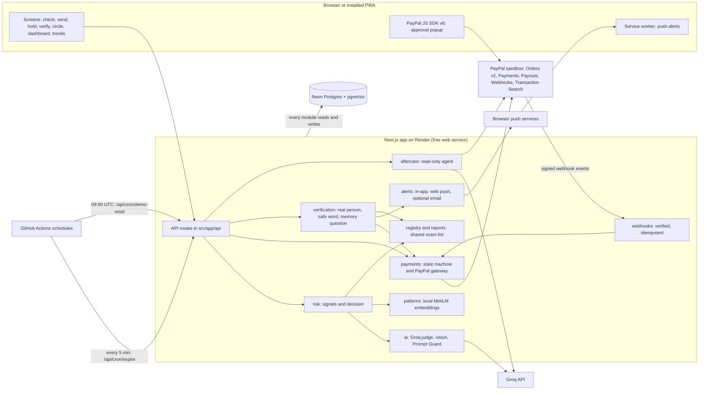
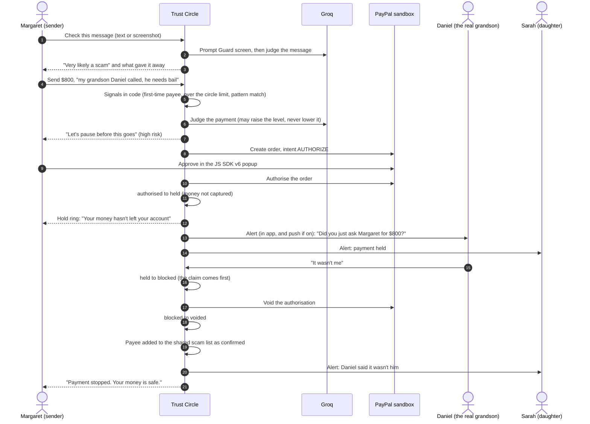
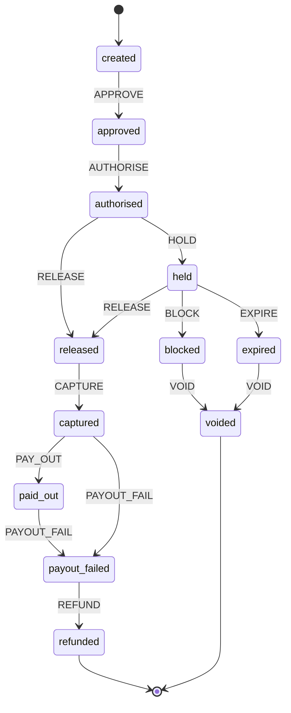

# Architecture

Trust Circle is one Next.js 16 (App Router, TypeScript) application. Its API routes call a set of small modules under `src/`. Postgres (with pgvector) is the only data store. Everything that touches PayPal runs against the sandbox: `src/payments/paypalGateway.ts` refuses any other base URL.

## Components

| Module | Folder | What it does |
|---|---|---|
| `risk` | `src/risk` | Computes signals in code (`signals.ts`), asks the AI, and decides (`decide.ts`). The final level is the higher of the rule level and the AI level. |
| `ai` | `src/ai` | Groq client, prompts, JSON schema checks, the Prompt Guard screen and the pattern describer. |
| `patterns` | `src/patterns` | Embeds text with `Xenova/all-MiniLM-L6-v2` inside the server process and searches anonymised scam scripts in pgvector. |
| `payments` | `src/payments`, `src/domain/paymentStateMachine.ts` | Orders, authorise, capture, void, payout and refund. Every money-moving PayPal call carries a `PayPal-Request-Id` built from the payment id. The sweep `expireStale` finishes anything left half done. |
| `verification` | `src/verification` | Asks the real person, falls back to the safe word or a memory question after 10 minutes, and shows official routes for an organisation. |
| `registry` | `src/registry`, `src/reports` | Shared scam list with confirmation rules, plus the one-tap report draft to PayPal. |
| `alerts` | `src/alerts`, `src/push` | In-app alerts, web push (`web-push`, VAPID) and email through Resend when a key is set. |
| `aftercare` | `src/aftercare` | A Groq tool loop over two read-only PayPal Agent Toolkit tools, scoped to one sender. Findings go on the circle dashboard. |
| `webhooks` | `src/webhooks`, `src/app/api/paypal/webhook/route.ts` | Verifies each event with PayPal, records it once per event id, and turns payout failures into `payout_failed`. |
| UI | `src/app`, `src/ui` | Sender screens, circle screens, onboarding, landing, AG Grid dashboard and AG Charts trends. |

`risk` knows nothing about PayPal. `payments` knows nothing about the AI. A failing alert, registry write or webhook handler never changes a payment's outcome (`emit` in `src/payments/paymentService.ts` logs and carries on).

## The lead story

Margaret's "grandson" calls from a new number and asks for $800 bail money. This is what happens.

If Daniel doesn't answer within 10 minutes, Margaret is coached through her safe word (or a memory question if none is set). A wrong answer or an excuse stops the payment; a right answer never releases a high-risk payment by itself. Sarah can approve or stop the payment at any time. After the cooling-off period (12, 24 or 48 hours, 24 by default) Margaret can release it herself, and if nobody acts the hold ends at 72 hours and the authorisation is voided.

## Payment states

Generated from `TRANSITIONS` in `src/domain/paymentStateMachine.ts`. Every transition writes an audit row.

- `RELEASE` and `BLOCK` are the claims. They are written before any PayPal call, so two people tapping at once can't both move money. After a claim, an error answers 202 ("we're finishing this payment for you") rather than inviting a second payment.
- `captured → payout_failed` happens when the first payout attempt gets a definite refusal from PayPal.
- `paid_out → payout_failed` is driven by a verified webhook: a payout item that is `RETURNED`, `FAILED`, `BLOCKED`, `CANCELED` or `REFUNDED`. `UNCLAIMED` and `SUCCEEDED` only add an audit row.
- The sweep (`expireStale`, run every 5 minutes) refunds `payout_failed` rows, voids blocked and expired holds, and resumes rows left in `approved`, `authorised`, `released` or `captured` for more than 5 minutes.

## Webhooks

`POST /api/paypal/webhook`:

1. Returns 503 if `PAYPAL_WEBHOOK_ID` isn't set, and 413 for a body over 256 KB.
2. Returns 400 if any of the five `paypal-*` signature headers is missing, or if PayPal's `/v1/notifications/verify-webhook-signature` doesn't answer `SUCCESS`. Nothing is stored before this check.
3. Claims the event id in the `webhook_events` table. A second delivery of a processed event is a no-op.
4. Applies it:
   - payout item events call `payoutOutcome` (above);
   - `PAYMENT.CAPTURE.COMPLETED`, `PAYMENT.CAPTURE.DENIED`, `PAYMENT.CAPTURE.REFUNDED`, `PAYMENT.AUTHORIZATION.VOIDED` and `CUSTOMER.DISPUTE.CREATED` are written to the audit log only, and only when the event carries a Trust Circle id (otherwise they are ignored).
5. A handler failure answers 500, so PayPal delivers it again, for up to 5 attempts. After that it answers 200 and the event stays recorded as failed. A failed payout that arrives while the payment is still `captured` is deferred (500) until the sweep settles it.

Logs carry event type, event id and payment id only.

## Aftercare

`POST /api/circle/aftercare` is for a member of the sender's circle. `src/aftercare/aftercareService.ts` gathers the sender's last 30 days of Trust Circle payments, and `src/aftercare/aftercareAgent.ts` runs the review:

1. Code calls `list_transactions` for the last 31 days first and passes the result to the model as data.
2. The Groq model may call at most 4 more tools within an 18-second budget.
3. The tool runner (`src/aftercare/tools.ts`) exposes only `list_transactions` and `get_order`. Any other name is refused, recorded as refused, and never reaches PayPal.
   - `list_transactions` results are cut down to rows whose `custom_id` is one of this sender's payment ids, and to date, amount and status only.
   - `get_order` works only on this sender's order ids.
4. A completed payment to an account now on the confirmed scam list always produces an "act" finding, whatever the model says. Sarah can copy a dispute draft for it (`src/aftercare/disputeDraft.ts`). Nothing is sent by the app.

If PayPal's history isn't available (Transaction Search is off for the app, or the call fails), the review uses Trust Circle's own records and says so. If the model fails, the code's own findings are shown and the summary says the AI review couldn't run. Sandbox Transaction Search data can lag by about 3 hours, and payments made before the `custom_id` was added carry no `custom_id`, so they never match.

## Hosting

| Piece | Where |
|---|---|
| Web service | Render free web service, from `render.yaml`. The start command (`npm run start:prod`) runs migrations with `scripts/migrate.mjs`, then `next start`. |
| Database | Neon free Postgres with the pgvector extension. |
| Hold expiry and keep-warm | `.github/workflows/expire.yml`, every 5 minutes, POSTs `/api/cron/expire` with `CRON_SECRET`. |
| Demo reset | `.github/workflows/demo-reset.yml`, daily at 09:00 UTC, POSTs `/api/cron/demo-reset`. The route answers 404 unless `DEMO_DAILY_RESET=1`. |
| Health | `GET /api/health` always answers 200 and reports whether the database answered. |

Step-by-step setup is in [deploy.md](deploy.md).
